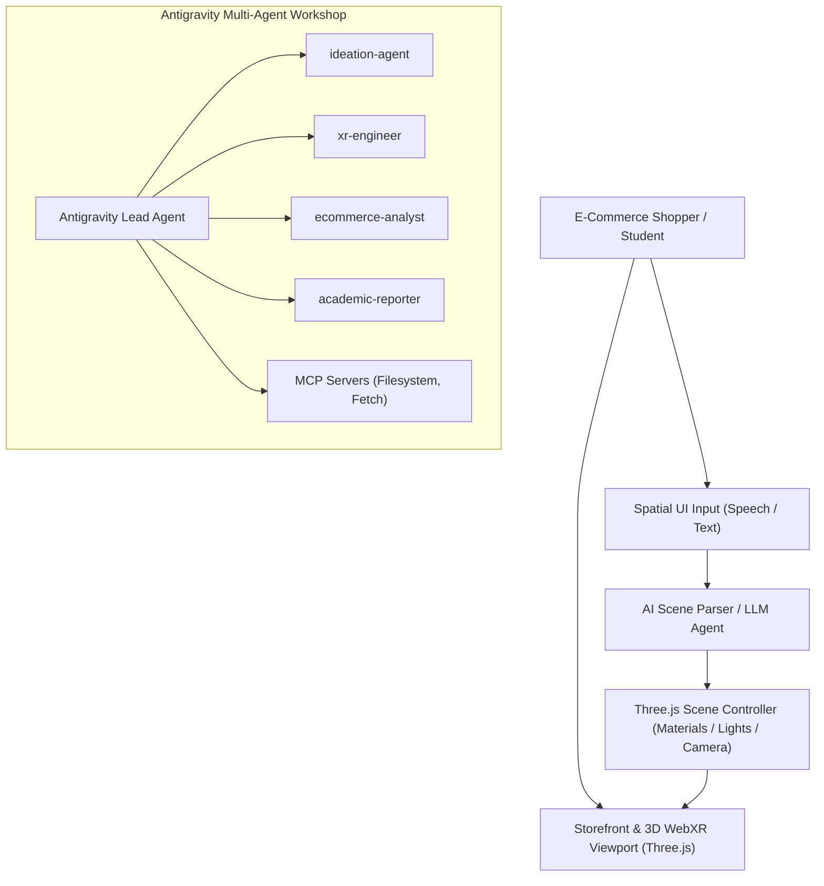

# Document 2: Brainstorming & Project Ideation Brief

## Project Title: SpatialCommerce 3D — Agent-Driven WebXR Product Configurator with AI Spatial UI

---

## 1. Bird’s-Eye View & Executive Summary
**SpatialCommerce 3D** is an interactive, browser-native 3D product visualizer and WebXR shopping widget tailored for modern e-commerce storefronts. Unlike conventional static image galleries or rigid 360-degree spin viewers, SpatialCommerce 3D delivers:
1. **Interactive 3D/XR Product Inspection**: Real-time 3D model orbit, zoom, mesh explosion, and dynamic studio lighting built on Three.js and WebXR.
2. **AI-Driven Spatial UI (Natural Language Customizer)**: A multimodal AI assistant embedded in the widget that interprets user text or voice requests (e.g. *"Show me the sneaker in cyberpunk neon colors with metallic sole"* or *"Explode the inner components"*) and executes dynamic Three.js material and scene alterations in real time.
3. **Multi-Agent AI Development Infrastructure**: Developed end-to-end within **Google Antigravity**, utilizing a coordinated multi-agent team (`ideation-agent`, `xr-engineer`, `ecommerce-analyst`, `academic-reporter`), custom Antigravity Skills, Rules, and Model Context Protocol (MCP) integrations.

---

## 2. Topic & Development Selection Rationale
- **Intersection of the Three Subjects**:
  - *Immersive Engineering*: Solves the requirement for dynamic 3D/XR environments, WebXR integration, interactive geometry, and scripted scene controls.
  - *E-Commerce Technologies*: Addresses real-world e-commerce friction (consumer uncertainty in online shopping), market/competitive analysis, and digital merchandising.
  - *AI Models & Simulators / Multi-Agent Systems*: Demonstrates AI project management using Google Antigravity, multi-agent coordination, and a built-in AI component (Spatial UI voice/text parser).
- **Thesis & Commercial Relevance**: The architecture addresses a multi-billion dollar problem in e-commerce: 20-30% of apparel and electronics returns stem from products not matching customer 2D expectations. By validating WebXR plus AI personalization, this project serves as a launchpad for the student's thesis and startup portfolio.

---

## 3. High-Level System Architecture

---

## 4. Key Deliverables & Milestone Scope
1. **Multi-Agent Configuration**: Rules (`AGENTS.md`), custom skills (`.agents/skills/`), and MCP server bindings (`mcp_config.json`).
2. **Functional 3D WebXR Prototype**: Responsive web app (`src/index.html`, `src/app.js`, `src/styles.css`) with 3D product rendering, PBR material switches, and WebXR toggle.
3. **Integrated AI Spatial Interface**: Natural Language command box allowing dynamic manipulation of colors, finishes, and camera perspectives.
4. **Exhaustive Academic Documentation**: Dual-documentation covering both the topic product aspect and the AI tooling workshop aspect, with visual intelligence and post-mortem analysis.
