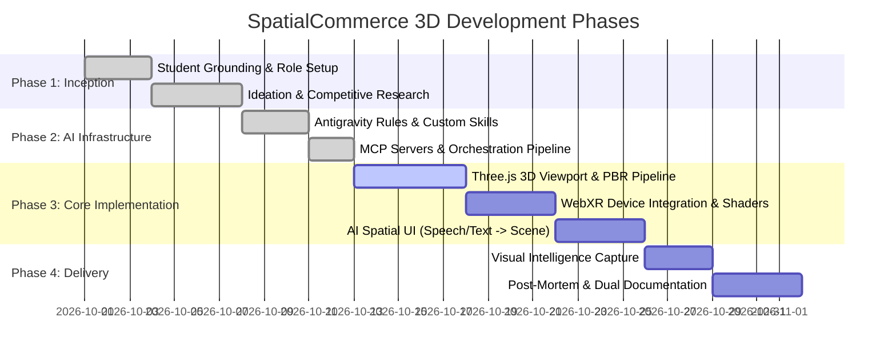

# Document 4: Project Plan & Progressive Specifications

## 1. Project Implementation Planes & Phased Roadmap

---

## 2. Progressive Technical Specifications

### Level 1: Baseline Foundation (Grade 3.0 Milestone)
- Clean Three.js canvas embedded in an HTML5 e-commerce page layout.
- Mouse orbit, zoom, and panning controls.
- Directional and ambient lighting rig displaying a 3D product geometry.
- Basic interactive button toggles for color swatches.
- Git repository initialized and pushed to GitHub with reviewer access granted.

### Level 2: Advanced Integration (Grade 4.0 Milestone)
- Full physically based rendering (PBR) materials with metallic, roughness, and emissive properties.
- WebXR button triggering immersive session (`immersive-vr` / `immersive-ar`) with fallback controls.
- Interactive multi-agent workspace in Google Antigravity configured with custom skills and workspace rules (`AGENTS.md`).
- Structured dual-documentation reflecting topic and AI tool dimensions.

### Level 3: Master / Exemplary Implementation (Grade 5.0 Milestone)
- **AI Spatial UI**: Conversational agent parsing natural language and voice input into structured JSON commands modifying 3D scene parameters dynamically.
- **Model Context Protocol (MCP)**: Live tool bindings allowing developer agents to inspect local project files and query remote documentation.
- **Comprehensive Post-Mortem**: Thorough forensic documentation of implementation challenges ("The Most Difficult Bug") and architectural lessons learned.
- **Visual Intelligence**: Rich Mermaid diagrams, terminal logs, code snippets, and UI captures embedded across reports.
